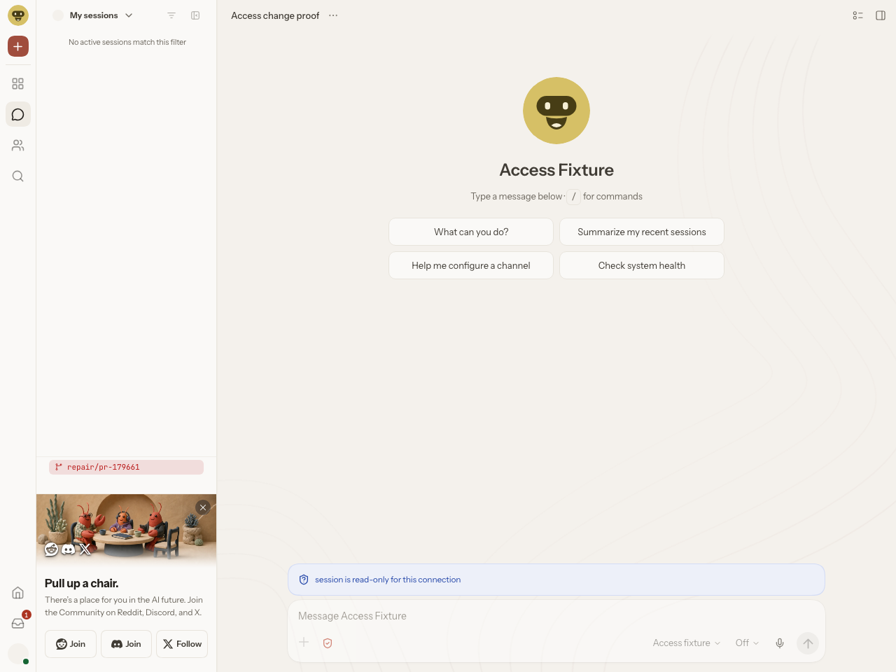
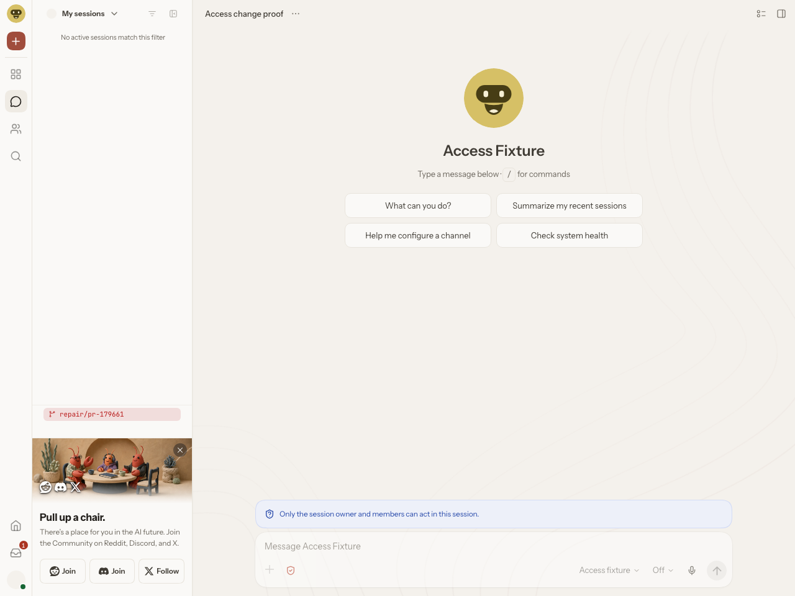
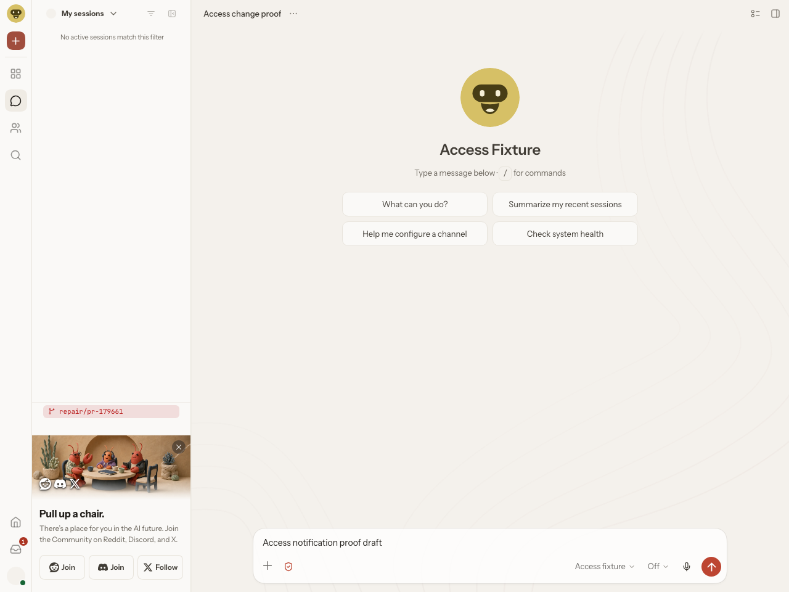

# PR #179661: current composer and final socket evidence

This packet projects ended, actual evidence for source commit `460d0939aa0e61336a470e5b359ac5fc4cdd11bb`, tree `d85955688e81a351efc4cb5f22271986fa7e7712`. It does not change the PR code, rerun the proof, or request another review. This packet is an immutable export snapshot. Its publication state and any actual remote push/readback receipt are recorded outside this packet; the snapshot itself does not assert that publication occurred.

## Current composer captures

These are exact original PNG bytes from UI04, not images from PR #169078. [UI04 observation projection](ui04.projection.json) binds each file hash to actual DOM enabledness and the same ended Gateway run. Pixels alone do not establish DOM enabledness. No chat.send or suggestion was submitted.

| State | Capture | Actual DOM enabled |
| --- | --- | --- |
| shared baseline | [01](images/01-shared-before.png) | true |
| read-only | [02](images/02-read-only-disabled.png) | false |
| shared restored | [03](images/03-shared-restored.png) | true |
| draft/revoked | [04](images/04-draft-revoked-disabled.png) | false |
| shared recovered | [05](images/05-shared-recovered.png) | true |
| suggestion enabled | [06](images/06-suggest-composer-enabled.png) | true |
| suggestion authority withdrawn, draft retained | [07](images/07-suggest-withdrawn-disabled.png) | false |
| shared restored, same draft retained | [08](images/08-shared-final-restored.png) | true |

Capture 07 actually displays “session is suggest for this connection”; this packet does not claim it displays revoked wording. Capture 03 and 05 legitimately have equal hashes. The Gateway lane uses a trusted loopback identity peer; it does not prove an external identity-provider flow or model inference. All owned actors joined in the final separate qualification.

## Authority drift through actual final WebSocket delivery

[The 155-row redacted trace](owner-transport.redacted.ndjson) retains all original source seq values. It is a field-allowlist projection, not byte-identical wire output. [The case projection](owner-transport.cases.projection.json) includes the actual oracle fields and exact row windows. Each case prepared/published once, committed real SQLite visibility `read-only`, and kept the viewer socket open. The unaffected control receives one allowed access frame. A real per-socket FIFO barrier proves the receiver drained the boundary.

| Boundary | Drift | Raw seq window | Stale viewer access send / receive | Allowed control send→receive | Viewer FIFO barrier send→receive |
| --- | --- | --- | --- | --- | --- |
| before-publication | identity reassignment | 34–47 | 0 / 0 | 34→39 | 43→45 |
| before-publication | write-scope withdrawal | 64–77 | 0 / 0 | 64→69 | 73→75 |
| owner-minted target Set | identity reassignment | 94–108 | 0 / 0 | 95→100 | 104→106 |
| owner-minted target Set | write-scope withdrawal | 125–139 | 0 / 0 | 126→131 | 135→137 |

Positive priming delivers access at viewer 2→8 and control 3→10. After restoring authority, viewer receives permitted read-write at 48→54, 78→84, 109→115, and 140→146. Late authority injection events are original rows 94 and 125; the driver checked their stack against the real owner target-Set line 322.

The scope cases withdraw `operator.write` while retaining `operator.read`; the event-scope predicate intentionally still allows the event. This checks stale prepared authority/cache-key admission, not withdrawal of every read/event scope. Identity/scope changes are explicit owner-composition fixtures, not a claim that a public authentication API silently reassigns an identity on an open connection.

Final all-join oracle totals are viewer 6 / control 10 / owner 0, including priming and restoration. They are not the per-case stale counts. The original inner observation has `wholeProofPass=false` because it awaits outer native finalization; that original is unchanged. A separate derived qualification records the actual native natural exit0, empty process group, final socket oracle and joined storage lifetime. Derived qualification/projections are not native receipts; source hashes are in [SOURCE-ARTIFACTS.json](SOURCE-ARTIFACTS.json). No historical failed run was relabeled successful.

Current production source, independently read at the same commit:

- [Publication authority recheck](https://github.com/openclaw/openclaw/blob/460d0939aa0e61336a470e5b359ac5fc4cdd11bb/src/gateway/server-connection-state.ts#L299)
- [Owner-minted target Set boundary](https://github.com/openclaw/openclaw/blob/460d0939aa0e61336a470e5b359ac5fc4cdd11bb/src/gateway/server-connection-state.ts#L322)
- [Exact owner admission consumed by broadcaster](https://github.com/openclaw/openclaw/blob/460d0939aa0e61336a470e5b359ac5fc4cdd11bb/src/gateway/server-broadcast.ts#L401)
- [Final production transport send](https://github.com/openclaw/openclaw/blob/460d0939aa0e61336a470e5b359ac5fc4cdd11bb/src/gateway/server-broadcast.ts#L713)

## Direction remains a maintainer decision

[Issue #112760](https://github.com/openclaw/openclaw/issues/112760) was closed by steipete as not planned on 2026-10-24. [The maintainer comment](https://github.com/openclaw/openclaw/issues/112760#issuecomment-6380197979) says current main resolved the original list-absence symptom and calls an explicit signal an optional follow-up, requiring a concrete current UI failure for a fresh issue. This packet demonstrates the implemented optional notification behavior; it does not claim maintainer acceptance of that contract or revive the closed issue. Earlier local human attachment choices were not a maintainer waiver.

## Redaction and integrity

[EXPORT-ALLOWLIST.json](EXPORT-ALLOWLIST.json) specifies retained fields, stable synthetic identifier aliases and omitted private fields. No config, SQLite database, token, private endpoint or absolute local path is included. Original PNGs are unmodified. [MANIFEST.sha256](MANIFEST.sha256) hashes every published packet file except the manifest itself. Original retained evidence stays separate and unchanged. All public links to this packet should use the actual published immutable artifact commit once confirmed; no placeholder URL is a publication receipt.
